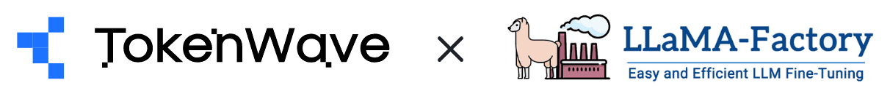

<p align="right"><b>English</b> · <a href="README.zh-CN.md">中文</a></p>

<p align="center">
  <picture>
    <source media="(prefers-color-scheme: dark)" srcset="assets/brand/tokenwave-llamafactory-dark.png">
    
  </picture>
</p>

# PRL: Programmable Reinforcement Learning for Agents

<p align="center"><a href="transforms/README.md">Docs</a> · <a href="#quick-start">Quick start</a> · <a href="https://huangtubaye233.github.io/tw-prl/">Blog</a> · <a href="README.zh-CN.md">中文</a></p>

**PRL** is an agentic RL training framework built on Miles. It lets you insert a flexible Python function into every trajectory **after it has finished and before the trainer computes its advantage**. The function can do three things:

1. **Reweight**: decide how much each step trains: not at all, or even pushed the other way.
2. **Rewrite**: change a step's reasoning, command or terminal output.
3. **Reroll**: let the policy run again from a step, several times; the new trajectories train too.

However complex the operation on a trajectory, it can be written as one such function.


- **One file**: write a function under `transforms/`; the file name is its name at run time.
- **Several algorithms**: GRPO, PPO and REINFORCE++ all work; switching is `ALGO=`.
- **Cheap to try**: the repo ships 8 real trajectories to try a function on; every training job also runs your function on them first and does not start if it raises, times out or skips them all.
- **Teacher / judge calls go through `ask`**: retries, rate limits, timeouts and fallback models are handled, and every call is recorded.
- **Ready transforms and a branch template**: use them as they are or start from them; transforms chain (`rewrite+atlas`).

## Example: ATLAS

ATLAS (Chen et al. 2025): a judge picks the critical steps of a trajectory; only those train, the others do not:

```python
# transforms/atlas.py   at run time: TRANSFORM=atlas
from prl.algo import labeler
from prl.transforms import Trajectory


async def atlas(traj: Trajectory, other_weight: float = 0.0) -> Trajectory:
    # 1. Ask the judge: the whole trajectory goes into a prompt; the judge answers which steps are critical.
    critical = await labeler.label(traj)

    # 2. Keep a record: transform.json then shows which steps the judge picked in each trajectory
    traj.record["atlas"] = {"steps": len(traj.steps),
                            "critical": None if critical is None else sorted(n + 1 for n in critical)}

    # 3. No usable answer from the judge: leave this one, it trains as plain GRPO
    if critical is None:
        traj.skip("the judge gave no usable answer (atlas_labels.json)")
        return traj

    # 4. Steps that are not critical: by default they do not train; with other_weight > 0 they train scaled
    for step in traj.steps:
        if step.index in critical:
            continue                      # critical step: keeps its GRPO advantage
        if other_weight == 0.0:
            step.mask()                   # out of the loss
        else:
            step.weight = other_weight    # advantage x other_weight
    return traj
```

It uses only Reweight. Given the returned `traj`, the framework removes the masked steps' tokens from the loss and trains the rest as usual.
To try it and train it: ② and ③ of the [Quick start](#quick-start).

## What your function can change

Your function gets one `traj`, marks its steps and returns it. What it can do comes in three layers, lightest first.

### Reweight: how much a step trains

The text of the trajectory stays; you only change the weight of each step (or of a span of text in a step) in the loss, including negative weights that push a bad step the other way.

| To | Write | The framework |
|---|---|---|
| not train a step | `step.mask()` | removes the step's tokens from the loss |
| train a step partly | `step.weight = 0.3` | scales the step's advantage by 0.3; negative = push the other way |
| weight only a span of a step | `step.weight_text("rm -rf build", -1.0)` | scales only that span's tokens |
| change the reward | `traj.reward = 1` | uses the new reward in the group normalization |

### Rewrite: what a step teaches

You change the text of the trajectory itself. The framework re-encodes only what changed; the rewritten text can serve as context only, out of the loss.

| To | Write | The framework |
|---|---|---|
| change reasoning / command / terminal output | `step.edit_thinking(old, new)`, `step.set_command({...})`, `step.set_terminal("...")` | re-encodes only the changed parts; the rewritten text can be context only, out of the loss |
| delete a whole turn | `step.delete()` | |

### Reroll: try again from a step

This layer samples more: the policy continues from the step you pick in a fresh sandbox, the tests grade it, and the new trajectory trains too.

| To | Write | The framework |
|---|---|---|
| let the policy run n more times from this step | `step.reroll(n=2, credit="subgroup")` | replays the steps before it in new sandboxes, the policy continues, the tests grade; the new trajectories train too (several steps are allowed; `credit`: see [Going further](#going-further)) |

### Helpers

| To | Write | The framework |
|---|---|---|
| ask a teacher / judge | `await ask(prompt, check=...)` | retries, rate limits, timeouts, the next model on a refusal; every call recorded |
| leave a trajectory alone | `traj.skip("reason")` | trains it unchanged and records the reason |
| keep a record | `traj.record["key"] = ...` | saves it in the trajectory's `transform.json` |

**Teacher**: called with `ask` from your function. It sees the whole trajectory and can score steps (→ Reweight),
point at the span that went wrong (→ `weight_text`), rewrite some steps (→ Rewrite), or pick a step for the policy to start over from (→ Reroll).

Full interface: [`transforms/README.md`](transforms/README.md).

## Methods implemented

Judge labels, teacher rewrites, branching from the middle: different ideas, but all of them act **after the trajectory has finished and before the trainer computes its advantage**; in PRL each is a transform.

Ready transforms:

| Name | What it does | Layers | Model calls per trajectory |
|---|---|---|---|
| `atlas` | a judge picks the critical steps; the others do not train (or train scaled) | Reweight | judge, 1 |
| `atlas_signed` | a judge marks good / bad steps, bad ones are pushed the other way; `quote_bad` pushes only the span that went wrong | Reweight | judge, 1 |
| `rewrite` | a teacher rewrites / fixes only failures / its text is context only / picks a step to start over from | Rewrite, Reroll | teacher, 1 |
| `branch` | branch template: select × allocate × credit | Reroll | depends on select (`first_bad`, `teacher`: 1 each) |

## Results

Every run trains Qwen3.5-9B on OpenThoughts-Agent-v1-RL and evaluates it on OpenThoughts-TB-dev.

| Run | Transform | TB-dev |
|---|---|---|
| Baseline | | 51.56% |
| GRPO | | 54.32% |
| PPO | (`ALGO=ppo`) | 54.84% |
| **Reweight** | | |
| ATLAS | `atlas` | 56.78% |
| signed ATLAS | `atlas_signed` | 58.09% |
| **Rewrite** | | |
| a teacher rewrites (the rewritten text is context only) | `rewrite` (`mask_new=True`) | 53.59% |
| a teacher inserts a sentence into the thinking | | 54.03% |
| **Reroll** | | |
| the policy starts over from a step the teacher picks | `rewrite` (`added="reroll"`) | 52.59% |

Reweight, Rewrite and Reroll all train end to end in a full run; how best to use a teacher's rewrites and branches is still wide open, and we encourage you to explore more ideas on top of this.

<!-- The synchronous reroll run goes under Reroll once its evaluation finishes. -->

## Quick start

**⓪ Set up.**

| Task | Requirements |
|---|---|
| write a function and try it on recorded trajectories (① ②) | Python ≥ 3.10 and `tokenizers`; the model's tokenizer (e.g. the `tokenizer.json` of Qwen/Qwen3.5-9B). If your function asks a model, a judge too (below) |
| train and evaluate on a cluster (③) | GPU nodes; the Miles container image; an E2B-compatible sandbox service; the training / evaluation data and the model weights. Steps: [`docs/setup.md`](docs/setup.md) |

**GPU**: any model; check `NUM_GPUS`, `PRL_GPU_MIN_MIB` and the memory settings in `configs/arms/common_ota_single_node.env`.

**Sandboxes**: PRL works with any E2B-compatible service; its endpoint and key file are in the site profile (`E2B_API_URL`, `E2B_DOMAIN`,
`E2B_API_KEY_FILE`).

**Judge / teacher** (the model `ask` calls): any OpenAI-compatible Chat Completions endpoint, set in the site profile (`configs/sites/<site>.env`, copied from `configs/sites/example.env`;
all judge settings: `configs/arms/ota_judge.env`):

```bash
PRL_JUDGE_API_BASE=https://<endpoint>/v1
PRL_JUDGE_MODEL=<model>
PRL_JUDGE_KEY_FILE=<key file>                           # chmod 600; the key is read from the file only, never logged
PRL_JUDGE_EXTRA_BODY='{"reasoning_effort": "medium"}'   # optional: parameters sent with every request
PRL_JUDGE_FALLBACK_MODELS=<model,...>                   # optional: the models to try in turn after a refusal
```

For the teacher, set a group of variables with another prefix (e.g. `PRL_TEACHER_*`) and call `ask(..., prefix="PRL_TEACHER_")`.

**① Write a function.**

In `transforms/my_transform.py`, write a function of the same name (file name, function name and run-time name agree):

```python
def my_transform(traj, **params):
    for step in traj.steps:
        ...                 # read the step, decide how much / what it trains, whether to try again (see above)
    return traj             # change nothing = plain GRPO
```

- **Input** `traj`: one finished, graded trajectory. `traj.task` is the task, `traj.reward` the test reward (0 / 1), `traj.steps`
  its turns (one turn = one model call), each with `step.thinking`, `step.command` and `step.terminal` (the terminal output after it ran).
- **Output**: the same `traj`; the marks you put on its steps are the output.
- **Parameters**: the function's keyword arguments are its run-time settings (`PRL_TRANSFORM_ARGS='{"other_weight": 0.3}'`).
- To ask a model, write `async def` and `await ask(...)`; otherwise a plain function. It is called once per trajectory.

**② Try it on recorded trajectories, no GPU.**

The repo ships 8 real training trajectories; your function runs on them (model calls included) and each decision is written to the output directory. From the repository root:

```bash
PRL_TRANSFORM=my_transform MODEL_HF_DIR=<tokenizer or HF model dir> \
PRL_TRANSFORM_CHECK_OUT=/tmp/check python -m prl.transforms.check
```

Reading the result:

- The terminal shows one line per trajectory: `[transform check] <trajectory>: reward <reward>, <steps> steps, <status>, trained tokens <before> -> <after>, <seconds> s`,
  where the status is `ok` or `skipped`. A last line `passed` means it passed; otherwise it prints `FAILED`, the trajectory and the reason.
- The output directory has one subdirectory per trajectory: `transform.json` is the framework's record (each function's status and time, what you wrote into `traj.record`,
  the trainable tokens before / after) and `transform_calls.json` every `ask` request and answer; `summary.json` sums up all 8.

**③ Train and evaluate.**

One command on a set-up cluster submits training → export → TB-dev evaluation:

```bash
PRL_SITE=<site> CHAIN=train_eval ARM=ota_train_transform TRANSFORM=my_transform PRL_RUN_ID=my_run \
  bash scripts/submit.sh
```

- Parameters: `PRL_TRANSFORM_ARGS='{"other_weight": 0.3}'`
- Algorithm: `ALGO=ppo` / `ALGO=reinforce_plus_plus`
- Chains: `TRANSFORM=rewrite+atlas` (run in order; `+`, not a comma, because the submit commands split variables on commas)
- The training job first runs your function on the recorded trajectories and does not start training if the function raises, times out or skips them all.

## Going further

**Signs (signed ATLAS, `atlas_signed.py`)**: the judge splits the steps into good and bad; a bad step of a successful trajectory gets `step.weight = -1`
and is pushed the other way. With `quote_bad=True` the judge must also quote the span that went wrong verbatim; only that span gets `weight_text(..., -1)`, the rest of the step
trains as usual. Still only the Reweight layer.

**Text (`rewrite.py`)**: a teacher improves the trajectory before it trains (`failures="fix"` fixes only failures, `r' = 1`); `mask_new=True` keeps
the teacher's text as context only, out of the loss. This uses the Rewrite layer. The criteria are in `transforms/rewrite_prompts/`; copy one to change it.

**Trying again (branches)**: in any function, pick a step and call `reroll`:

```python
traj.steps[k].reroll(n=2, credit="subgroup")   # the policy runs 2 more times from step k
```

The first k steps are replayed as they were in new sandboxes; from step k on the policy generates anew and the tests grade. How a new trajectory is scored is up to `credit`:

- `member`: the new trajectory is one more member of the group and enters its mean and variance.
- `subgroup`: the new trajectory is compared only with those from the same start: the original trajectory from step k on, plus the other branches at that step.
  The original keeps its group advantage before step k and takes the subgroup's value from step k on. GRPO only.

A run with branches needs the arm with the branch post-processing: `ARM=ota_train_transform_reroll`.

**Branch template (`branch.py`)**: the usual branching methods answer three questions; the template makes each a plug-in, combined in one line of configuration,
and each can be replaced by any function:

```bash
TRANSFORM=branch PRL_TRANSFORM_ARGS='{
  "select":   "first_bad",
  "allocate": {"name": "fixed", "n": 2, "view": "trial"},
  "credit":   "subgroup"
}'
```

| Plug-in | Question | Options |
|---|---|---|
| `select` | where to branch | `middle` · `teacher` (a teacher picks the step and may edit the steps before it) · `first_bad` (the first bad step the judge marks) · `surprisal` (the step that surprised the policy most) · your function |
| `allocate` | how many times | `fixed` (n per step; `only` picks failures / successes / all); `view`: this trajectory alone (`trial`) or the whole group (`group`, planned) |
| `credit` | how a new trajectory is scored | `member` · `subgroup` (`value` planned) |

What each option means: [`transforms/README.md`](transforms/README.md#3-branch-template).

<!-- A Citation section follows once the paper is public. -->

## Acknowledgements

PRL builds on Miles and slime (training framework), SGLang (rollout), Megatron-LM (training), Harbor / Terminus-2 (agent and evaluation environment),
E2B (sandboxes), LiteLLM (Harbor's model calls), and ATLAS (Chen et al. 2025).

## License

PRL is released under the [Apache License 2.0](LICENSE), as Miles is. The upstream code vendored in `third_party/` keeps its own license.

<p align="center">
  <picture>
    <source media="(prefers-color-scheme: dark)" srcset="assets/brand/tokenwave-llamafactory-dark.png">
    
  </picture>
</p>
