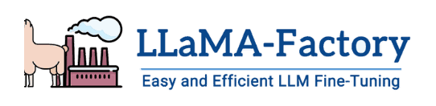
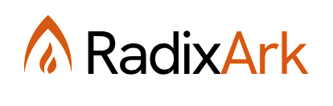
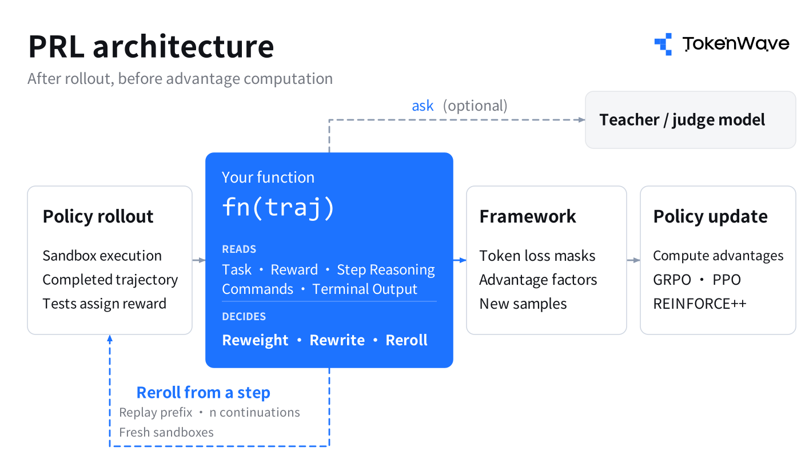

<p align="right"><b>English</b> · <a href="README.zh-CN.md">中文</a></p>

<p align="center">
  <a href="https://github.com/TokenWave-AI"></a>
  &nbsp;&nbsp;
  <a href="https://github.com/hiyouga/LlamaFactory"></a>
  &nbsp;&nbsp;
  <a href="https://radixark.com/"></a>
</p>

# PRL: Programmable Reinforcement Learning for Agents

<p align="center"><a href="transforms/README.md">Docs</a> · <a href="#quick-start">Quick start</a> · <a href="https://tokenwave-ai.github.io/PRL/">Blog</a> · <a href="README.zh-CN.md">中文</a></p>

**PRL** is an agentic RL training framework built on Miles. It lets you insert a flexible Python function into every trajectory **after it has finished and before the trainer computes its advantage**. The function can do three things:

1. **Reweight**: decide how much each step trains: not at all, or even pushed the other way.
2. **Rewrite**: change a step's reasoning, command or terminal output.
3. **Reroll**: let the policy run again from a step, several times; the new trajectories train too.

However complex the operation on a trajectory, it can be written as one such function.



- **One file**: write a function under `transforms/`; the file name is its name at run time.
- **Several algorithms**: GRPO, PPO and REINFORCE++ all work; switching is `ALGO=`.
- **Cheap to try**: the repo ships 8 real trajectories to try a function on; every training job also runs your function on them first and does not start if it raises, times out or skips them all.
- **Teacher / judge calls go through `ask`**: retries, rate limits, timeouts and fallback models are handled, and every call is recorded.
- **Ready transforms and a branch template**: use them as they are or start from them; transforms chain (`rewrite+atlas`).

## Example: ATLAS

[ATLaS: Agent Tuning via Learning Critical Steps](https://arxiv.org/abs/2503.02197) (Chen et al., ACL 2025): a judge picks the critical steps of a trajectory; only those train, the others do not:

```python
# transforms/atlas.py   at run time: TRANSFORM=atlas
from prl.algo import labeler
from prl.transforms import Trajectory


async def atlas(traj: Trajectory, other_weight: float = 0.0) -> Trajectory:
    # 1. Ask the judge: the whole trajectory goes into a prompt; the judge answers which steps are critical.
    critical = await labeler.label(traj)

    # 2. Keep a record: transform.json then shows which steps the judge picked (numbered from 1, as in its prompt)
    traj.record["atlas"] = {"steps": len(traj.steps),
                            "critical": None if critical is None else sorted(n + 1 for n in critical)}

    # 3. No usable answer from the judge: leave this one, it trains as plain GRPO
    if critical is None:
        traj.skip("the judge gave no usable answer (atlas_labels.json)")
        return traj

    # 4. Steps that are not critical: by default they do not train; with other_weight > 0 they train scaled
    for step in traj.steps:
        if step.index in critical:
            continue                      # critical step: keeps its GRPO advantage
        if other_weight == 0.0:
            step.mask()                   # out of the loss
        else:
            step.weight = other_weight    # advantage x other_weight
    return traj
```

It uses only Reweight. Given the returned `traj`, the framework removes the masked steps' tokens from the loss and trains the rest as usual.

**Run it, one command**: train Qwen3.5-9B with ATLAS on OpenThoughts-Agent-v1-RL, then evaluate it on TB-dev (one job on 4 GPUs, about 15 h):

```bash
PRL_SITE=mysite TRANSFORM=atlas bash scripts/quickstart.sh
```

`mysite` is your cluster's site profile, set up once as the [Quick start](#quick-start) shows, step by step; to try the function without a GPU first, on 8 recorded trajectories: [Quick start ②](#quick-start).

## What your function can change

Your function gets one `traj`, marks its steps and returns it. What it can do comes in three layers, lightest first.

### Reweight: how much a step trains

The text of the trajectory stays; you only change the weight of each step (or of a span of text in a step) in the loss, including negative weights that push a bad step the other way.

| To | Write | The framework |
|---|---|---|
| not train a step | `step.mask()` | removes the step's tokens from the loss |
| train a step partly | `step.weight = 0.3` | scales the step's advantage by 0.3; negative = push the other way |
| weight only a span of a step | `step.weight_text("rm -rf build", -1.0)` | scales only that span's tokens |
| change the reward | `traj.reward = 1` | uses the new reward in the group normalization |

### Rewrite: what a step teaches

You change the text of the trajectory itself. The framework re-encodes only what changed; the rewritten text can serve as context only, out of the loss.

| To | Write | The framework |
|---|---|---|
| change reasoning / command / terminal output | `step.edit_thinking(old, new)`, `step.set_command({...})`, `step.set_terminal("...")` | re-encodes only the changed parts; the rewritten text can be context only, out of the loss |
| delete a whole turn | `step.delete()` | |

### Reroll: try again from a step

This layer samples more: the policy continues from the step you pick in a fresh sandbox, the tests grade it, and the new trajectory trains too.

| To | Write | The framework |
|---|---|---|
| let the policy run n more times from this step | `step.reroll(n=2, credit="subgroup")` | replays the steps before it in new sandboxes, the policy continues, the tests grade; the new trajectories train too (several steps are allowed; `credit`: see [Going further](#going-further)) |
| ... with a hint for those runs | `step.reroll(n=2, credit="verified", hint="Re-read the task.")` | shows the hint to the policy before the step: part of its prompt, never trained |

Not for a trajectory the context summary split into parts (`traj.split`): check it before you call `reroll`.

### Helpers

| To | Write | The framework |
|---|---|---|
| ask a teacher / judge | `await ask(prompt, check=...)` | retries, rate limits, timeouts, the next model on a refusal; every call recorded |
| leave a trajectory alone | `return traj` (change nothing) | trains it unchanged |
| give up on a trajectory | `traj.skip("reason")` | trains it unchanged and records the reason; many in a row stop the run (`PRL_TRANSFORM_MAX_FAILURES`) |
| keep a record | `traj.record["key"] = ...` | saves it in the trajectory's `transform.json` |

**Teacher**: called with `ask` from your function. It sees the whole trajectory and can score steps (→ Reweight),
point at the span that went wrong (→ `weight_text`), rewrite some steps (→ Rewrite), or pick a step for the policy to start over from (→ Reroll).

Full interface: [`transforms/README.md`](transforms/README.md).

## Methods implemented

Judge labels, teacher rewrites, branching from the middle: different ideas, but all of them act **after the trajectory has finished and before the trainer computes its advantage**; in PRL each is a transform.

Ready transforms:

| Name | What it does | Layers | Model calls per trajectory |
|---|---|---|---|
| `atlas` | a judge picks the critical steps; the others do not train (or train scaled); `select="random"`: random steps of the same token share instead, the control without a judge | Reweight | judge, 1 (random: 0) |
| `atlas_signed` | a judge marks good / bad steps, bad ones are pushed the other way; `quote_bad` pushes only the span that went wrong | Reweight | judge, 1 |
| `rewrite` | a teacher rewrites / fixes only failures / its text is context only / picks a step to start over from | Rewrite, Reroll | teacher, 1 |
| `branch` | branch template: select × allocate × credit | Reroll | depends on select (`first_bad`, `teacher`: 1 each) |
| `hint_reroll` | a judge names a failed trajectory's first wrong step and writes a hint of at most 15 words (where to look again, no command); the policy tries again from there twice with it, `credit="verified"` | Reroll | judge, 1 |

## Results

Every run trains Qwen3.5-9B on OpenThoughts-Agent-v1-RL and evaluates it on OpenThoughts-TB-dev.

| Run | Transform | TB-dev |
|---|---|---|
| Baseline | | 51.56% |
| GRPO | | 54.32% |
| PPO | (`ALGO=ppo`) | 54.84% |
| **Reweight** | | |
| ATLAS | `atlas` | 56.78% |
| signed ATLAS | `atlas_signed` (`failed_good_weight=0`) | 58.09% |
| **Rewrite** | | |
| a teacher rewrites (the rewritten text is context only) | `rewrite` (`mask_new=True`) | 53.59% |
| a teacher inserts a sentence into the thinking | | 54.03% |
| **Reroll** | | |
| the policy starts over from a step the teacher picks | `rewrite` (`added="reroll"`) | 52.59% |

Reweight, Rewrite and Reroll all train end to end in a full run; how best to use a teacher's rewrites and branches is still wide open, and we encourage you to explore more ideas on top of this.

<!-- The synchronous reroll run goes under Reroll once its evaluation finishes. -->

## Quick start

You need: one node of 4 GPUs (≥ 90 GB each, ≥ 768 GB of RAM) with Apptainer or SingularityCE, an E2B-compatible sandbox service with a container registry it pulls from, an OpenAI-compatible endpoint for the judge, and a linux/amd64 machine with Docker for steps 4–5 (it may be the cluster). Details: [`docs/setup.md`](docs/setup.md).

**1. Get the code** on the cluster, in a directory the compute nodes can write:

```bash
git clone https://github.com/TokenWave-AI/PRL.git && cd PRL
```

**2. Write your site profile**: copy the example, then fill in its first block (the scheduler and queue, a work directory `PRL_EXT`, the sandbox service, the registry, the judge). SingularityCE instead of Apptainer, or Python < 3.10 on the hosts: also uncomment its "Only for some sites".

```bash
cp configs/sites/example.env configs/sites/mysite.env      # mysite: any name; then edit the file
```

**3. Put the key files** where the profile looks for them (`/path/to/work` is your `PRL_EXT`):

```bash
mkdir -p /path/to/work/private && chmod 700 /path/to/work/private
cp <sandbox service key> /path/to/work/private/e2b_api_key
cp <judge key> /path/to/work/private/judge_api_key
cp <registry credentials> /path/to/work/private/registry_credentials.json   # only where step 5 builds: {"username": ..., "password": ...}
chmod 600 /path/to/work/private/*
```

**4. Log Docker in to the registry**, on the machine with Docker (the build runs `sudo docker`):

```bash
sudo docker login <registry>
```

(Docker that needs its own config directory: `PRL_DOCKER_COMMAND="sudo docker --config <dir>"`, [`docs/sandboxes.md`](docs/sandboxes.md).)

**5. Build the sandboxes** (an image and a template per task) on that machine; for a first try only the smoke's 8 tasks, about 10 minutes:

```bash
PRL_SITE=mysite PRL_SANDBOX_SMOKE_ONLY=1 bash scripts/setup/build_sandboxes.sh
```

Docker on another machine than the cluster: there too steps 1–4 with the same `configs/sites/mysite.env` (git ignores it: copy it) and `PRL_EXT` set to a directory of that machine, then copy what step 5 made to the cluster: `rsync -a <that PRL_EXT>/task_snapshots <cluster>:/path/to/work/` ([`docs/setup.md`](docs/setup.md#site-specifics)).

**6. Run** on the cluster's login node. With the 8 sandboxes it tries signed ATLAS on them (2 updates, about 30 min; the job asks for 2 h); the first job also pulls the container image, downloads the tasks and the weights and checks the 8 sandboxes. It prints where its logs are.

```bash
PRL_SITE=mysite bash scripts/quickstart.sh
```

`DRY_RUN=1` in front prints the scheduler command and submits nothing; a busy queue: `QUEUE=<queue>` (a short debug queue: with `ELAPSE=01:00:00`).

**7. See the first update** in the run's `train.log` (the path step 6 printed):

```bash
grep -m1 "step 0:" /path/to/work/runs/grpo_ota_train_smoke_<job id>/train.log
```

**8. Train for real**: build the other sandboxes (hours), then the same command trains Qwen3.5-9B on OpenThoughts-Agent-v1-RL (68 updates) and evaluates it on TB-dev, in one job of about 15 h:

```bash
PRL_SITE=mysite bash scripts/setup/build_sandboxes.sh      # on the machine with Docker, as in step 5
PRL_SITE=mysite bash scripts/quickstart.sh                 # on the cluster, as in step 6
```

**Options** (steps 6 and 8):

- Another transform: `TRANSFORM=atlas` (any of `transforms/`, yours too: below); the default is signed ATLAS, 58.09% in the results, with the judge at the reasoning effort low that its arm sets (`PRL_JUDGE_EXTRA_BODY`; the 58.09% run used gpt-6.1-sol).
- Parameters: `PRL_TRANSFORM_ARGS='{"other_weight": 0.3}'`; algorithm: `ALGO=reinforce_plus_plus` (`ALGO=ppo` after its own smoke, [`CONTRIBUTING.md`](CONTRIBUTING.md)); chains: `TRANSFORM=rewrite+atlas` (run in order; `+`, not a comma, because the submit commands split variables on commas), with params per name: `PRL_TRANSFORM_ARGS='{"atlas": {"other_weight": 0.3}}'`.
- What the transform did, a line per trajectory in `train.log`: `[prl] transform <name> on <trajectory>: ok; steps changed: <e.g. 5 weighted, 2 masked>; <kept>/<all> trained tokens kept` (`[prl] step weights: ...`, one line per training rank, counts samples, a trajectory split by the context summary being several, and step weights only, not masks; its last count, `with subgroup advantage spans`, the original trajectories scored against their reroll siblings from a branch point on: with `verified` only those a branch beat). The pass rate of the trajectories is `rollout/episode_raw_reward`; `rollout/raw_reward_unfiltered` counts samples (a branch, a split trajectory's parts). The TB-dev score is `eval/heldout` in the evaluation's `train.log`; from the trials: `python3 scripts/tools/tbdev_score.py --samples 8 <the eval's harbor_trials>` (a trial the sandbox service failed runs again, up to 2 more times, and `--samples` leaves the failed attempts out; `PRL_EVAL_SANDBOX_RETRIES=0` scores it 0 as TB-dev's own scoring does, and `--drop-sandbox-failures` compares with such an evaluation).
- A full run stopped by its time limit goes on when the same command is run again.

**Your own transform: write, try, train.**

**① Write a function.** In `transforms/my_transform.py`, write a function of the same name (file name, function name and run-time name agree):

```python
def my_transform(traj, **params):
    for step in traj.steps:
        ...                 # read the step, decide how much / what it trains, whether to try again (see above)
    return traj             # change nothing = plain GRPO
```

- **Input** `traj`: one finished, graded trajectory. `traj.task` is the task's prompt (the harness's whole first prompt, the task inside it), `traj.reward` the test reward (0 / 1), `traj.steps`
  its turns (one turn = one model call), each with `step.thinking`, `step.command` and `step.terminal` (the terminal output after it ran).
- **Output**: the same `traj`; the marks you put on its steps are the output.
- **Parameters**: the function's keyword arguments are its run-time settings (`PRL_TRANSFORM_ARGS='{"other_weight": 0.3}'`).
- To ask a model, write `async def` and `await ask(...)` (`from prl.transforms import ask`); otherwise a plain function. It is called once per trajectory.

**② Try it on recorded trajectories, no GPU.** The repo ships 8 real training trajectories; your function runs on them (model calls included) and each decision is written to the output directory. With Python ≥ 3.10, from the repository root:

```bash
python3 -m venv .venv && . .venv/bin/activate && pip install -e '.[check]'
hf download Qwen/Qwen3.5-9B tokenizer.json --local-dir tokenizer   # the model's tokenizer
PRL_TRANSFORM=my_transform MODEL_HF_DIR=tokenizer \
PRL_TRANSFORM_CHECK_OUT=/tmp/check python -m prl.transforms.check
```

A function that asks a model uses the judge of the site profile: `set -a; source configs/sites/mysite.env; set +a` first (on another machine than the cluster, `export PRL_JUDGE_KEY_FILE=<the key file here>` before it). What the quick start trains by default: `PRL_TRANSFORM=atlas_signed PRL_TRANSFORM_ARGS='{"failed_good_weight": 0.0}'`. The training arm may set more judge settings than the profile (signed ATLAS: `PRL_JUDGE_EXTRA_BODY='{"reasoning_effort": "low"}'`); set them here too to check with the same ones. Reuse an output directory only empty: files of an earlier check stay.

- The terminal shows one line per trajectory: `[transform check] <trajectory>: reward <reward>, <steps> steps, <status>, steps changed: <e.g. 5 weighted, 2 masked>, trained tokens <before> -> <after>, <seconds> s`,
  where the status is `ok` or `skipped` (a skipped line ends with the reason; between them the framework's own lines, `[prl] transform ... trained tokens kept`, and with a judge its HTTP requests). A last line `passed` means it passed; otherwise it prints `FAILED`, the trajectory and the reason.
- The output directory has one subdirectory per trajectory: `transform.json` is the framework's record (each function's status and time, what you wrote into `traj.record`,
  the steps it changed, e.g. `weighted_steps` {step: new weight}, the trainable tokens before / after) and `transform_calls.json` every `ask` request and answer (the ATLAS judge's: `atlas_labels.json`); `summary.json` sums up all 8.
- The step lists count from 0, as `step.index`; the judges' own numbers (ATLAS' `critical`, `good` / `bad`, `atlas_labels.json`; `hint_reroll`'s `step`) from 1, as in their prompts.
- The recorded trajectories have no rollout log probs (`surprisal` sees all 0) and no test output (`hint_reroll`'s judge sees none): such choices show in training only. Your own trajectories: `scripts/tools/make_transform_fixture.py` makes a fixture from a run's `traces/rollout_data/<update>.pt`, `PRL_TRANSFORM_FIXTURE=<it>` checks on it.
- A reroll is only recorded here (`reroll` in `transform.json`: the steps and the turns to replay); its branches run in training, where the quick start picks the arm a reroll needs by itself.

**③ Train and evaluate it**: `PRL_SITE=mysite TRANSFORM=my_transform bash scripts/quickstart.sh`. It reads your file to tell whether it needs the judge (`ask`, ATLAS' labeler) and the reroll arm (`.reroll(`); when that guesses wrong, say it: `PRL_NEEDS_JUDGE=0` or `1`, `ARM=ota_train_transform` or `ota_train_transform_reroll`. The job first runs your function on the recorded trajectories and does not start training if it raises, times out or skips them all.

## Going further

**Signs (signed ATLAS, `atlas_signed.py`)**: the judge splits the steps into good and bad; a bad step of a successful trajectory gets `step.weight = -1`
and is pushed the other way. With `quote_bad=True` the judge must also quote the span that went wrong verbatim; only that span gets `weight_text(..., -1)`, the rest of the step
trains as usual. Still only the Reweight layer.

**Text (`rewrite.py`)**: a teacher improves the trajectory before it trains (`failures="fix"` fixes only failures, `r' = 1`); `mask_new=True` keeps
the teacher's text as context only, out of the loss. This uses the Rewrite layer. The criteria are in `transforms/rewrite_prompts/`; copy one to change it.

**Trying again (branches)**: in any function, pick a step and call `reroll`:

```python
traj.steps[k].reroll(n=2, credit="subgroup")   # the policy runs 2 more times from step k
```

The first k steps are replayed as they were in new sandboxes; from step k on the policy generates anew and the tests grade. How a new trajectory is scored is up to `credit`:

- `member`: the new trajectory is one more member of the group and enters its mean and variance.
- `subgroup`: the new trajectory is compared only with those from the same start: the original trajectory from step k on, plus the other branches at that step.
  The original keeps its group advantage before step k and takes the subgroup's value from step k on. GRPO only.
- `verified`: as `subgroup` when a branch scored more than the original (the state at step k could still succeed), and then the original's steps before k get advantage 0 (not blamed); when no branch did, the original trains as in GRPO. GRPO only.

`reroll(..., hint="...")` shows the branches' policy a hint before step k (part of its prompt, never trained); `hint_reroll.py` asks a judge for one.

A run with branches needs the arm with the branch post-processing: `ARM=ota_train_transform_reroll`.

**Branch template (`branch.py`)**: the usual branching methods answer three questions; the template makes each a plug-in, combined in one line of configuration,
and each can be replaced by any function:

```bash
TRANSFORM=branch PRL_TRANSFORM_ARGS='{
  "select":   "first_bad",
  "allocate": {"name": "fixed", "n": 2, "view": "trial"},
  "credit":   "subgroup"
}'
```

| Plug-in | Question | Options |
|---|---|---|
| `select` | where to branch | `middle` · `teacher` (a teacher picks the step and may edit the steps before it) · `first_bad` (the first bad step the judge marks) · `surprisal` (the step that surprised the policy most) · your function |
| `allocate` | how many times | `fixed` (n per step; `only` picks failures / successes / all); `view`: this trajectory alone (`trial`) or the whole group (`group`, planned) |
| `credit` | how a new trajectory is scored | `member` · `subgroup` · `verified` (`value` planned) |

What each option means: [`transforms/README.md`](transforms/README.md#3-branch-template).

## Citation

**Authors:** Kefan Yu\*, Jiarui Liu\*, Qingcheng Zeng, Yaqian Wang, Heli Qi, Enduo Zhao, Stephen Huang, Eli Cheung, Qian Liu, Yaowei Zheng, Chenyang Zhao, Weihao Xuan (\* equal contribution)

If you find this repository useful, please cite:

```bibtex
@misc{prl2026,
  title        = {{PRL}: Programmable Reinforcement Learning for Agents},
  author       = {Yu, Kefan and Liu, Jiarui and Zeng, Qingcheng and
                  Wang, Yaqian and Qi, Heli and Zhao, Enduo and
                  Huang, Stephen and Cheung, Eli and Liu, Qian and
                  Zheng, Yaowei and Zhao, Chenyang and Xuan, Weihao},
  year         = {2026},
  howpublished = {\url{https://github.com/TokenWave-AI/PRL}}
}
```

The `atlas` and `atlas_signed` transforms follow ATLaS; if you use them, please also cite:

```bibtex
@inproceedings{chen2025atlas,
  title     = {{ATLaS}: Agent Tuning via Learning Critical Steps},
  author    = {Chen, Zhixun and Li, Ming and Huang, Yuxuan and Du, Yali and Fang, Meng and Zhou, Tianyi},
  booktitle = {Proceedings of the 63rd Annual Meeting of the Association for Computational Linguistics (ACL)},
  year      = {2025},
  url       = {https://arxiv.org/abs/2503.02197}
}
```

## Acknowledgements

PRL builds on Miles and slime (training framework), SGLang (rollout), Megatron-LM (training), Harbor / Terminus-2 (agent and evaluation environment),
E2B (sandboxes), LiteLLM (Harbor's model calls), and [ATLaS: Agent Tuning via Learning Critical Steps](https://arxiv.org/abs/2503.02197) (Chen et al., ACL 2025).

## License

PRL is released under the [Apache License 2.0](LICENSE), as Miles is. The upstream code vendored in `third_party/` keeps its own license.

<p align="center">
  <a href="https://github.com/TokenWave-AI"></a>
  &nbsp;
  <a href="https://github.com/hiyouga/LlamaFactory"></a>
  &nbsp;
  <a href="https://radixark.com/"></a>
</p>
