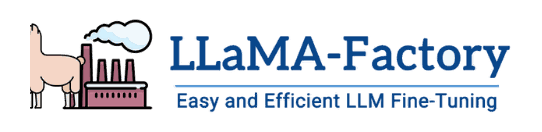
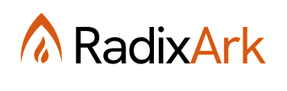
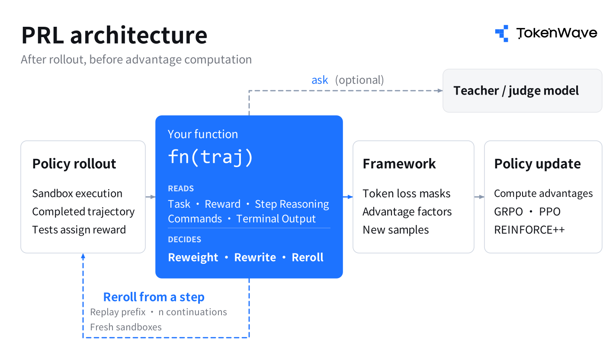

<p align="right"><a href="README.md">English</a> · <b>中文</b></p>

<p align="center">
  <a href="https://github.com/TokenWave-AI"></a>
  &nbsp;&nbsp;
  <a href="https://github.com/hiyouga/LlamaFactory"></a>
  &nbsp;&nbsp;
  <a href="https://radixark.com/"></a>
</p>

# PRL: Programmable Reinforcement Learning for Agents

<p align="center"><a href="transforms/README.zh-CN.md">文档</a> · <a href="#快速开始">快速开始</a> · <a href="https://tokenwave-ai.github.io/PRL/">博客</a> · <a href="README.md">English</a></p>

**PRL** 是一个基于 Miles 的 Agentic RL 训练框架。PRL 允许每条轨迹在**跑完之后、训练计算 advantage 之前**插入一个高度灵活的 Python 函数。函数里能做三件事：

1. **Reweight**：决定每一步的权重：可以不学，也可以反着推。
2. **Rewrite**：改掉某一步的推理、命令或终端输出。
3. **Reroll**：让策略从某一步重新跑几次，新轨迹也参与训练。

再复杂的轨迹操作，都可以写成这样一个函数。



- **仅需单文件**：在 `transforms/` 下写一个函数，文件名就是运行时的名字。
- **支持多算法**：GRPO / PPO / REINFORCE++ 三种算法都能用，换算法只改 `ALGO=`。
- **轻量化试错**：仓库自带 8 条真实轨迹供试跑；训练作业开头也会先试跑你的函数，报错、超时或全部跳过就不开训。
- **教师 / 判官调用交给 `ask`**：重试、限流、超时、换备选模型，每次调用都存档。
- **现成 transform 和分支模板**：直接用或在上面改；transform 可以串联（`rewrite+atlas`）。

## 例：ATLAS

[ATLaS: Agent Tuning via Learning Critical Steps](https://arxiv.org/abs/2503.02197)（Chen et al.，ACL 2025）：判官从轨迹里挑出关键步，只学关键步，其余步不学：

```python
# transforms/atlas.py   运行时：TRANSFORM=atlas
from prl.algo import labeler
from prl.transforms import Trajectory


async def atlas(traj: Trajectory, other_weight: float = 0.0) -> Trajectory:
    # 1. 问判官：把整条轨迹写成 prompt，判官回答哪几步是关键步。
    critical = await labeler.label(traj)

    # 2. 留记录：之后在 transform.json 里能看到每条轨迹判官选了哪几步（从 1 数，和它的 prompt 一致）
    traj.record["atlas"] = {"steps": len(traj.steps),
                            "critical": None if critical is None else sorted(n + 1 for n in critical)}

    # 3. 判官没给出能用的答案：这条不处理，按原生 GRPO 训练
    if critical is None:
        traj.skip("the judge gave no usable answer (atlas_labels.json)")
        return traj

    # 4. 非关键步：默认不学；other_weight > 0 时改成按比例学
    for step in traj.steps:
        if step.index in critical:
            continue                      # 关键步：保持 GRPO 的 advantage
        if other_weight == 0.0:
            step.mask()                   # 移出 loss
        else:
            step.weight = other_weight    # advantage × other_weight
    return traj
```

它只用了 Reweight。框架拿到返回的 `traj` 后，把被 mask 的步对应的 token 从 loss 里去掉，其余照常。

**一条命令跑起来**：用 ATLAS 在 OpenThoughts-Agent-v1-RL 上训练 Qwen3.5-9B，再在 TB-dev 上评测（一个作业，4 张卡，约 15 小时）：

```bash
PRL_SITE=mysite TRANSFORM=atlas bash scripts/quickstart.sh
```

`mysite` 是你集群的站点配置，一次性配置见[快速开始](#快速开始)，一步一步来；想先不用 GPU、在 8 条录好的轨迹上试这个函数：[快速开始 ②](#快速开始)。

## 函数里能动什么

你的函数拿到一条 `traj`，在步骤上做标记，再把它返回。能做的事分三层，从轻到重。

### Reweight：这一步学多少

轨迹的文字不变；你只改每一步（或一步里的一段文字）在 loss 中的权重，包括用负数把坏步反着推。

| 你想做的 | 写法 | 框架做什么 |
|---|---|---|
| 这一步不学 | `step.mask()` | 这一步的 token 移出 loss |
| 这一步学多少 | `step.weight = 0.3` | 这一步的 advantage × 0.3；负数 = 反着推 |
| 只调这一步里的一段文字 | `step.weight_text("rm -rf build", -1.0)` | 只有这段文字的 token 乘系数 |
| 改分数 | `traj.reward = 1` | 新分数参与组内归一化 |

### Rewrite：这一步学什么

你改的是轨迹的文字本身。框架只重新编码被改动的部分；改写后的文字可以只做上下文，不进 loss。

| 你想做的 | 写法 | 框架做什么 |
|---|---|---|
| 改推理 / 命令 / 终端输出 | `step.edit_thinking(old, new)`、`step.set_command({...})`、`step.set_terminal("...")` | 只重新编码改动的部分；改写的文字可以只做上下文、不进 loss |
| 删掉整轮 | `step.delete()` | |

### Reroll：从这一步再试一次

这一层会多采样：策略从你选的那一步开始，在新沙盒里接着跑，测试打分，新轨迹也参与训练。

| 你想做的 | 写法 | 框架做什么 |
|---|---|---|
| 从这一步开始让策略再跑 n 次 | `step.reroll(n=2, credit="subgroup")` | 新沙盒重放前几步，策略接着跑，测试打分；新轨迹也参与训练（可以多处，`credit` 见[进阶用法](#进阶用法)） |
| ……并给这几次一句提示 | `step.reroll(n=2, credit="verified", hint="Re-read the task.")` | 在这一步之前把提示给策略看：属于 prompt，不训练 |

被上下文总结切开的轨迹（`traj.split`）不能分支：调 `reroll` 前先判断。

### 辅助功能

| 你想做的 | 写法 | 框架做什么 |
|---|---|---|
| 问教师 / 判官 | `await ask(prompt, check=...)` | 重试、限流、超时、被拒时换备选模型，每次调用都存档 |
| 这条不处理 | `return traj`（什么都不改） | 原样训练 |
| 这条做不了 | `traj.skip("原因")` | 原样训练，原因记下来；连续太多条会停掉训练（`PRL_TRANSFORM_MAX_FAILURES`） |
| 留记录 | `traj.record["key"] = ...` | 存进这条轨迹的 `transform.json` |

**教师**：通过在函数里 `ask` 调用；它看得到整条轨迹，可以给步骤打分（→ Reweight）、
指出出错的那段文字（→ `weight_text`）、改写某几步（→ Rewrite）、选一个步骤让策略从那里重来（→ Reroll）。

完整接口参考：[`transforms/README.zh-CN.md`](transforms/README.zh-CN.md)。

## 已经实现的方法

判官打标、教师改写、从中间分支——这些方法思路各异，但都作用在**轨迹跑完之后、训练算 advantage 之前**；在 PRL 里，每个方法都是一个 transform。

现有 transform：

| 名字 | 做法 | 用到的层 | 每条轨迹的模型调用 |
|---|---|---|---|
| `atlas` | 判官选关键步，其余不学（或按比例学）；`select="random"`：换成 token 占比相同的随机步，不用判官的对照 | Reweight | 判官 1 次（random：0） |
| `atlas_signed` | 判官分好 / 坏步，坏步反着推；`quote_bad` 只推出错的那段文字 | Reweight | 判官 1 次 |
| `rewrite` | 教师改写 / 只修失败的 / 教师的文字只做上下文 / 教师选点后重来 | Rewrite、Reroll | 教师 1 次 |
| `branch` | 分支模板：select × allocate × credit | Reroll | 取决于 select（`first_bad`、`teacher` 各 1 次） |
| `hint_reroll` | 判官找失败轨迹第一个走错的步骤，写一句不超过 15 词的提示（只说回头看哪里，不给命令）；策略带着提示从那里再试 2 次，`credit="verified"` | Reroll | 判官 1 次 |

## 结果

所有运行基于 Qwen3.5-9B 在 OpenThoughts-Agent-v1-RL 上训练，在 OpenThoughts-TB-dev上评测。

| 运行 | transform | TB-dev |
|---|---|---|
| Baseline | | 51.56% |
| GRPO | | 54.32% |
| PPO |（`ALGO=ppo`） | 54.84% |
| **Reweight** | | |
| ATLAS | `atlas` | 56.78% |
| signed ATLAS | `atlas_signed`（`failed_good_weight=0`） | 58.09% |
| **Rewrite** | | |
| 教师改写（改写部分只做上下文） | `rewrite`（`mask_new=True`） | 53.59% |
| 教师在 thinking 里插一句 | | 54.03% |
| **Reroll** | | |
| 策略从教师选定步重来 | `rewrite`（`added="reroll"`） | 52.59% |

Reweight、Rewrite、Reroll 三层都能在完整训练里跑通；教师的改写和分支怎么用好还有很大探索空间，欢迎大家在此基础上开发更多玩法。

<!-- 同步训练的 reroll 评测完后补在 Reroll 下面。 -->

## 快速开始

需要：一个 4 卡节点（每张 ≥ 90 GB，内存 ≥ 768 GB），装有 Apptainer 或 SingularityCE；一个兼容 E2B 的沙盒服务，和它拉镜像用的容器 registry；判官用的 OpenAI 兼容接口；第 4–5 步要一台有 Docker 的 linux/amd64 机器（可以就是集群）。细节见 [`docs/setup.md`](docs/setup.md)。

**1. 拿代码**：在集群上、计算节点能写的目录里：

```bash
git clone https://github.com/TokenWave-AI/PRL.git && cd PRL
```

**2. 写站点配置**：复制示例，填好最上面一段（调度器和队列、工作目录 `PRL_EXT`、沙盒服务、registry、判官）。用 SingularityCE 而不是 Apptainer，或者机器上 Python < 3.10：再把 "Only for some sites" 一段对应的行取消注释。

```bash
cp configs/sites/example.env configs/sites/mysite.env      # mysite 可以随便取名；然后编辑这个文件
```

**3. 放 key 文件**，放到配置会去找的位置（`/path/to/work` 就是你的 `PRL_EXT`）：

```bash
mkdir -p /path/to/work/private && chmod 700 /path/to/work/private
cp <沙盒服务的 key> /path/to/work/private/e2b_api_key
cp <判官的 key> /path/to/work/private/judge_api_key
cp <registry 凭据> /path/to/work/private/registry_credentials.json   # 只在第 5 步建沙盒的机器上：{"username": ..., "password": ...}
chmod 600 /path/to/work/private/*
```

**4. 让 Docker 登录 registry**，在有 Docker 的那台机器上（建沙盒时调用的是 `sudo docker`）：

```bash
sudo docker login <registry>
```

（Docker 要用自己的配置目录时：`PRL_DOCKER_COMMAND="sudo docker --config <dir>"`，见 [`docs/sandboxes.md`](docs/sandboxes.md)。）

**5. 建沙盒**（每个任务一个镜像和一个 template），还是在那台机器上；第一次先只建烟测的 8 个任务，约 10 分钟：

```bash
PRL_SITE=mysite PRL_SANDBOX_SMOKE_ONLY=1 bash scripts/setup/build_sandboxes.sh
```

Docker 不在集群上时：在那台机器上也做第 1–4 步，用同一份 `configs/sites/mysite.env`（git 不管它，要自己复制过去），`PRL_EXT` 设成那台机器上的目录；第 5 步做完后把结果拷到集群：`rsync -a <那台机器的 PRL_EXT>/task_snapshots <集群>:/path/to/work/`（[`docs/setup.md`](docs/setup.md#site-specifics)）。

**6. 运行**，在集群的登录节点上。只建了 8 个沙盒时，它在这 8 个任务上试 signed ATLAS（2 次更新，约 30 分钟；作业申请 2 小时）；第一个作业还会拉容器镜像、下载任务和权重、检查这 8 个沙盒。命令会打印日志在哪里。

```bash
PRL_SITE=mysite bash scripts/quickstart.sh
```

前面加 `DRY_RUN=1` 只打印调度器命令、不提交；队列太挤：加 `QUEUE=<队列>`（短的 debug 队列再加 `ELAPSE=01:00:00`）。

**7. 看第一次更新**，在这次运行的 `train.log` 里（第 6 步打印的路径）：

```bash
grep -m1 "step 0:" /path/to/work/runs/grpo_ota_train_smoke_<作业 ID>/train.log
```

**8. 正式训练**：把其余的沙盒建好（几个小时），同一条命令就在 OpenThoughts-Agent-v1-RL 上训练 Qwen3.5-9B（68 次更新），再在 TB-dev 上评测，一个作业约 15 小时：

```bash
PRL_SITE=mysite bash scripts/setup/build_sandboxes.sh      # 在有 Docker 的机器上，同第 5 步
PRL_SITE=mysite bash scripts/quickstart.sh                 # 在集群上，同第 6 步
```

**可选项**（第 6、8 步）：

- 换 transform：`TRANSFORM=atlas`（`transforms/` 里的任意一个，包括你自己写的，见下）；默认是 signed ATLAS，结果表里的 58.09%，判官用它的 arm 设的 reasoning effort low（`PRL_JUDGE_EXTRA_BODY`；58.09% 那次用的是 gpt-6.1-sol）。
- 改参数：`PRL_TRANSFORM_ARGS='{"other_weight": 0.3}'`；换算法：`ALGO=reinforce_plus_plus`（`ALGO=ppo` 要先跑它自己的烟测，见 [`CONTRIBUTING.md`](CONTRIBUTING.md)）；串联：`TRANSFORM=rewrite+atlas`（按顺序执行；用 `+` 不用逗号，因为提交命令按逗号切分变量），参数按名字给：`PRL_TRANSFORM_ARGS='{"atlas": {"other_weight": 0.3}}'`。
- transform 对每条轨迹做了什么，`train.log` 里各有一行 `[prl] transform <名字> on <轨迹>: ok; steps changed: <如 5 weighted, 2 masked>; <保留>/<全部> trained tokens kept`（`[prl] step weights: ...` 每个训练 rank 一行，按样本计数，被上下文总结切开的轨迹算多个样本，而且只统计步骤权重，不含 mask；它最后一项 `with subgroup advantage spans` 是从分支点起和 reroll 兄弟比较打分的原轨迹数：`verified` 只算被分支超过的那些）。轨迹的通过率是 `rollout/episode_raw_reward`；`rollout/raw_reward_unfiltered` 按样本算（分支、被切开轨迹的各段都算）。TB-dev 分数是评测那份 `train.log` 里的 `eval/heldout`；从 trial 算：`python3 scripts/tools/tbdev_score.py --samples 8 <评测的 harbor_trials>`（被沙盒服务弄失败的 trial 会再跑，最多再 2 次，`--samples` 把失败的那几次去掉；`PRL_EVAL_SANDBOX_RETRIES=0` 则像 TB-dev 自己的打分一样记 0，和这样的评测比用 `--drop-sandbox-failures`）。
- 完整训练到时限被停掉的话，再运行同一条命令会接着跑。

**写自己的 transform：写、试、训。**

**① 写一个函数。** 在 `transforms/my_transform.py` 里写一个同名函数（文件名、函数名、运行时的名字三处一致）：

```python
def my_transform(traj, **params):
    for step in traj.steps:
        ...                 # 读这一步，决定它学多少 / 学什么 / 要不要重来（见上面的"函数里能动什么"）
    return traj             # 什么都不改 = 原生 GRPO
```

- **输入** `traj`：一条跑完、打过分的轨迹。`traj.task` 是题目的 prompt（harness 的整段第一条 prompt，题目在里面），`traj.reward` 是测试分数（0 / 1），`traj.steps`
  是每一轮（一轮 = 一次模型调用），每一步有 `step.thinking`、`step.command`、`step.terminal`（执行后的终端输出）。
- **输出**：同一个 `traj`，你在步骤上做的标记就是输出。
- **参数**：函数的关键字参数就是运行时配置（`PRL_TRANSFORM_ARGS='{"other_weight": 0.3}'`）。
- 要问模型时写成 `async def`，用 `await ask(...)`（`from prl.transforms import ask`）；不问模型就写普通函数。一条轨迹调用一次。

**② 不用 GPU，先在录好的轨迹上试。** 仓库带了 8 条真实训练轨迹，你的函数会在上面跑一遍（包括问模型），每条的决定写到输出目录。需要 Python ≥ 3.10，在仓库根目录运行：

```bash
python3 -m venv .venv && . .venv/bin/activate && pip install -e '.[check]'
hf download Qwen/Qwen3.5-9B tokenizer.json --local-dir tokenizer   # 模型的 tokenizer
PRL_TRANSFORM=my_transform MODEL_HF_DIR=tokenizer \
PRL_TRANSFORM_CHECK_OUT=/tmp/check python -m prl.transforms.check
```

函数要问模型的话，用站点配置里的判官：先运行 `set -a; source configs/sites/mysite.env; set +a`（不在集群上运行时，在这之前 `export PRL_JUDGE_KEY_FILE=<本机的 key 文件>`）。快速开始默认训练的是 `PRL_TRANSFORM=atlas_signed PRL_TRANSFORM_ARGS='{"failed_good_weight": 0.0}'`。训练用的 arm 可能比站点配置多设几个判官参数（signed ATLAS：`PRL_JUDGE_EXTRA_BODY='{"reasoning_effort": "low"}'`），想用同样的设置检查就在这里也设上。输出目录要用空的：上一次检查的文件会留着。

- 终端里每条轨迹一行：`[transform check] <轨迹>: reward <分数>, <步数> steps, <状态>, steps changed: <如 5 weighted, 2 masked>, trained tokens <改前> -> <改后>, <秒数> s`，
  状态是 `ok` 或 `skipped`（skipped 的行末尾写着原因；中间夹着框架自己的日志行 `[prl] transform ... trained tokens kept`，问判官时还有它的 HTTP 请求）。最后一行是 `passed` 为通过；出错时打印 `FAILED`、出错的轨迹和原因。
- 输出目录里每条轨迹一个子目录：`transform.json` 是框架的记录（每个函数的状态和用时、你写进 `traj.record` 的内容、
  改了哪些步骤，如 `weighted_steps` {步骤: 新权重}、可训练 token 改前 / 改后的数量），`transform_calls.json` 是每次 `ask` 的请求和回答（ATLAS 判官的在 `atlas_labels.json`）；`summary.json` 汇总全部 8 条。
- 步骤列表从 0 数，和 `step.index` 一样；判官自己的编号（ATLAS 的 `critical`、`good` / `bad`、`atlas_labels.json`；`hint_reroll` 的 `step`）和它们的 prompt 一样从 1 数。
- 录好的轨迹没有 rollout log prob（`surprisal` 看到的都是 0），也没有测试输出（`hint_reroll` 的判官看不到）：这类选择只在训练里看得出来。用自己的轨迹：`scripts/tools/make_transform_fixture.py` 从一次运行的 `traces/rollout_data/<update>.pt` 做 fixture，`PRL_TRANSFORM_FIXTURE=<它>` 就在它上面检查。
- reroll 在这里只记录请求（`transform.json` 的 `reroll`：从哪些步分支、要重放哪些轮），分支在训练时才真正跑；训练时快速开始会自动选 reroll 需要的 arm。

**③ 训练 + 评测**：`PRL_SITE=mysite TRANSFORM=my_transform bash scripts/quickstart.sh`。它读你的文件判断要不要判官（`ask`、ATLAS 的 labeler）和 reroll arm（`.reroll(`）；判断错了就直接说：`PRL_NEEDS_JUDGE=0` 或 `1`，`ARM=ota_train_transform` 或 `ota_train_transform_reroll`。作业开头会先在录好的轨迹上试跑你的函数，函数报错、超时或全部跳过就不开训。

## 进阶用法

**加正负号（signed ATLAS，`atlas_signed.py`）**：判官把步骤分成好 / 坏，成功轨迹里的坏步 `step.weight = -1`，
被反着推。加 `quote_bad=True`，判官还要原样引用出错的那段文字，只有那段 `weight_text(..., -1)`，同一步里
其余文字照常学。仍然只用 Reweight 这一层。

**改文字（`rewrite.py`）**：教师把轨迹改好再学（`failures="fix"` 只修失败的，`r' = 1`）；`mask_new=True` 让
教师写的文字只做上下文、不进 loss。用到 Rewrite 这一层。判断标准在 `transforms/rewrite_prompts/`，复制一份就能改。

**再试一次（分支）**：在任意函数里，选一步调用 `reroll`：

```python
traj.steps[k].reroll(n=2, credit="subgroup")   # 从第 k 步开始让策略再跑 2 次
```

前 k 步在新沙盒里原样重放，第 k 步起由策略重新生成，测试打分。新轨迹怎么算分由 `credit` 决定：

- `member`：新轨迹作为这一组多出来的成员，和其他轨迹一起算均值、方差。
- `subgroup`：新轨迹只和"同一起点出发的"比，也就是原轨迹从第 k 步起的部分加上同处的其他分支。
  原轨迹在第 k 步之前保持组 advantage，从第 k 步起换成这个小组里比出来的值。只支持 GRPO。
- `verified`：有分支比原轨迹分高（第 k 步的状态还能成功）时同 `subgroup`，并且原轨迹第 k 步之前的 advantage 记 0（不背锅）；没有分支比它高时，原轨迹照 GRPO 训练。只支持 GRPO。

`reroll(..., hint="...")` 在第 k 步之前给分支里的策略一句提示（属于 prompt，不训练）；`hint_reroll.py` 让判官来写。

用分支的运行要换成带分支后处理的 arm：`ARM=ota_train_transform_reroll`。

**分支模板（`branch.py`）**：常见的分支方法都在回答三个问题，模板把它们拆成三个可换的插件，一行配置组合，
每个插件也可以换成任意函数：

```bash
TRANSFORM=branch PRL_TRANSFORM_ARGS='{
  "select":   "first_bad",
  "allocate": {"name": "fixed", "n": 2, "view": "trial"},
  "credit":   "subgroup"
}'
```

| 插件 | 回答的问题 | 选项 |
|---|---|---|
| `select` | 在哪分支 | `middle` · `teacher`（教师选步，可以先改前面几步）· `first_bad`（判官标的第一个坏步骤）· `surprisal`（策略最"意外"的一步）· 你的函数 |
| `allocate` | 分几次 | `fixed`（每处 n 次，`only` 选只给失败 / 成功 / 全部）；`view` 选只看这一条（`trial`）还是看整组再分（`group`，规划中） |
| `credit` | 新轨迹怎么算分 | `member` · `subgroup` · `verified`（`value` 规划中） |

选项具体含义见 [`transforms/README.zh-CN.md`](transforms/README.zh-CN.md#3-分支模板)。

## 引用

**作者：** Kefan Yu\*, Jiarui Liu\*, Qingcheng Zeng, Yaqian Wang, Heli Qi, Enduo Zhao, Stephen Huang, Eli Cheung, Qian Liu, Yaowei Zheng, Chenyang Zhao, Weihao Xuan（\* 共同第一作者）

如果用到 PRL，请引用（GitHub 上的 "Cite this repository" 按钮读的是 [`CITATION.cff`](CITATION.cff) 里的同一份信息）：

```bibtex
@misc{prl2026,
  title        = {{PRL}: Programmable Reinforcement Learning for Agents},
  author       = {Yu, Kefan and Liu, Jiarui and Zeng, Qingcheng and
                  Wang, Yaqian and Qi, Heli and Zhao, Enduo and
                  Huang, Stephen and Cheung, Eli and Liu, Qian and
                  Zheng, Yaowei and Zhao, Chenyang and Xuan, Weihao},
  year         = {2026},
  howpublished = {\url{https://github.com/TokenWave-AI/PRL}}
}
```

`atlas` 和 `atlas_signed` 两个 transform 沿用 ATLaS 的方法；用到它们时，也请引用：

```bibtex
@inproceedings{chen2025atlas,
  title     = {{ATLaS}: Agent Tuning via Learning Critical Steps},
  author    = {Chen, Zhixun and Li, Ming and Huang, Yuxuan and Du, Yali and Fang, Meng and Zhou, Tianyi},
  booktitle = {Proceedings of the 63rd Annual Meeting of the Association for Computational Linguistics (ACL)},
  year      = {2025},
  url       = {https://arxiv.org/abs/2503.02197}
}
```

## 致谢

本项目建立在以下工作之上：Miles 和 slime（训练框架），SGLang（rollout），Megatron-LM（训练），Harbor / Terminus-2（agent 与评测环境），
E2B（沙盒），LiteLLM（Harbor 调模型），以及 [ATLaS: Agent Tuning via Learning Critical Steps](https://arxiv.org/abs/2503.02197)（Chen et al.，ACL 2025）。

## 许可

PRL 以 [Apache License 2.0](LICENSE) 发布，与 Miles 相同。`third_party/` 里的上游代码沿用各自的许可。

<p align="center">
  <a href="https://github.com/TokenWave-AI"></a>
  &nbsp;
  <a href="https://github.com/hiyouga/LlamaFactory"></a>
  &nbsp;
  <a href="https://radixark.com/"></a>
</p>
